  

  
  
  

### What I build

I turn manual, inbox-and-spreadsheet processes into systems that run themselves, built on the tools a business already owns.

- **Automation:** Power Automate flows, SharePoint, Dataverse, and Teams Adaptive Cards
- **AI:** Claude API and Copilot Studio agents that score, summarize, and route work, with a human making the call
- **Data:** Python, SQL, and REST APIs to move and shape data where it needs to go

### Toolbox

### Certifications

  
  
  
  
  

AWS Community Builder · Postman API Expert · **Next up:** Microsoft PL-900 → PL-400
