  

  
  
  

### 👋 Who I am

Every team has that one process. The spreadsheet someone updates by hand every Monday. The approval stuck in somebody's inbox. The request that got answered three days late because nobody saw it come in.

**I'm the person who finds it, maps it, and builds the system that makes it disappear.**

I've been building on Microsoft Power Platform since 2019. Along the way I've worked in enterprise IT, spent two years in AWS cloud billing turning messy cost data into answers, and became the go-to person on my teams for turning "we do this manually" into "this runs itself." A design background makes me care how a tool looks and feels. A Master of Public Administration taught me to ask whether a system actually works for the people using it.

Today I build with AI in the loop: Power Platform for the plumbing, Copilot Studio and the Claude API for the thinking, and a human always making the final call.

### 🔧 What I build

| The problem | What I build |
|---|---|
| Leads and requests arrive by email and sit unread | Intake forms that log every request, score it with AI, and route it to the right person in Teams |
| Approvals live in inboxes and nobody knows the status | Ticket workflows with Adaptive Card approvals, status tracking, and a single list of record |
| Data has to be copied between systems by hand | API pipelines that pull data into SharePoint or Excel on a schedule and survive schema changes |
| Costs or numbers spike and no one notices until month end | Monitoring with automatic alerts, forecasting, and dashboards people actually read |
| The same questions get asked over and over | Copilot Studio and Claude agents grounded in a team's own documents |

Every build keeps a human in the loop: AI drafts, scores, and suggests; people decide.

### 🧰 Stack

  

### 🎯 Where I'm headed

Turning the patterns above into repeatable **3509 Innovations** offers, so growing teams get enterprise-grade automation without an enterprise IT department. Next on the build list: Dataverse, model-driven apps, and Copilot Studio agents with proper ALM.

### 🤝 Work with me

**Hiring?** I'm open to **Power Platform Developer**, **Solutions Engineer**, and **Business Systems Engineer** roles (remote). [Let's talk on LinkedIn →](https://www.linkedin.com/in/nicoledcoleman/)

**Need a build?** 3509 Innovations takes on contract automation projects: intake, approvals, data pipelines, and AI agents. [See my work →](https://iamnicolecoleman.com)

### 🏅 Certifications

  
  
  
  
  

AWS Community Builder · Postman API Expert · **Next up:** Microsoft PL-900 → PL-400
